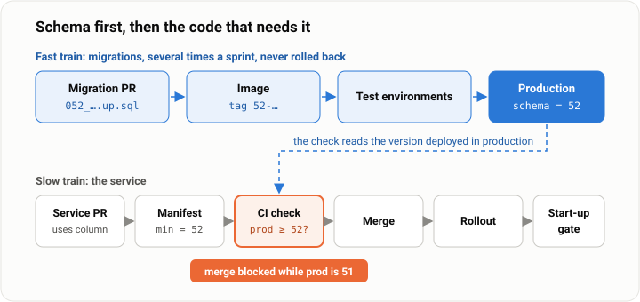
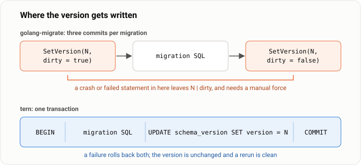
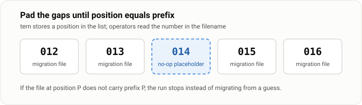

A handful of Go services I work on, each with its own Postgres database, had a rule on paper that every release can be rolled back. In practice none of them could. Two things stood in the way:

- The services ran [golang-migrate](https://github.com/golang-migrate/migrate) at start-up, from SQL embedded in the binary. An old binary started against a database already migrated to n+1 fails, so rolling the service back meant rolling the schema back too.
- Nothing checked that version n of the code works against schema n+1. Backward compatibility was a convention.

This post is about the tool we built to fix that. I gave it as a [talk at the Prague Go meetup]() in November, with [slides](https://speakerdeck.com/abtris/migrations-that-never-roll-back) and [video](https://www.youtube.com/watch?v=rcx25t-Rqnc); this is the written version. Names of services, tables and metrics are changed, the design is not.

## The rule

Migrations ship first and never roll back, so the service always can.

That is expand/contract (DORA calls it the [parallel change pattern](https://dora.dev/capabilities/database-change-management/)) turned into a release process. The migrations of a service become their own deployable with their own image and their own release train. That train reaches production first and only moves forward. Every code change has to work with the schema already in production, and every schema change has to work with the code already in production.

None of this is new. Google's [F1 schema change paper](https://research.google/pubs/online-asynchronous-schema-change-in-f1/) makes the same point at a much larger scale: servers switch schema at different moments, so a change has to pass through intermediate states that are safe for both the old and the new code. We have one database per service and far fewer servers, but old and new code coexisting is exactly the situation a rollback creates.

A feature that needs a new column now takes two releases. Ship the migration, wait for it to land, then ship the code that uses it.



## What is wrong with the dirty flag

golang-migrate keeps one row: a version and a `dirty` boolean. Per migration it commits three times. It sets the version with `dirty = true`, runs the SQL, then sets the version again with `dirty = false`. A crash or a failing statement in between leaves `N | dirty` behind, and every later run refuses until a human works out which statements ran, repairs the schema by hand and runs `force`.

This is not hypothetical. While reading version tables in a test environment I found this, from a migration stream whose first migration failed and was then abandoned:

```
db=> select * from migrations;
 version | dirty
---------+-------
       1 | t
```

Nobody had noticed, because it was nobody's active table. That is how dirty state survives.

Our first attempt stayed inside golang-migrate: a SQLFluff rule that forces every file into `BEGIN; ... COMMIT;`. It helps, since the file's own SQL becomes atomic. But the two version writes are still separate commits, so the window is still there. A linter can enforce what is in the file. It cannot move the version bump inside the transaction.

## tern, and one commit instead of three

The engine is [jackc/tern](https://github.com/jackc/tern). It is pgx-native, which our services already are, so `database/sql` and `lib/pq` drop out of the dependency tree. It takes an advisory lock so two runners cannot interleave. And it runs each migration and its own version bump in one transaction:

```sql
begin;
  alter table resources add column owner text;
  reset all;
  update schema_version set version = 52;
commit;
```

A failure rolls everything back, the version is unchanged, and a rerun is clean. There is no dirty column and nothing to force.



Statements that cannot run in a transaction, such as `CREATE INDEX CONCURRENTLY`, opt out with an explicit marker in the file. The guarantee does not hold for those, and the loader logs every one of them.

## Position is not prefix

tern has a quirk that shaped most of the layer around it. Its version table stores a *position*: 1 to N in the order migrations were appended. It indexes its migration slice with the stored value and rejects anything above the slice length.

We needed the stored number to be the numeric prefix from the filename. Existing databases already sit at some version and must not be re-stamped, and an operator should read the same number in the filename, the table, the metric and the image tag.

One column cannot be both unless the two are equal, so the loader makes them equal. Files are sorted by prefix and every gap in the numbering gets a no-op placeholder. One of our services skips 014, so it carries one placeholder.



Before migrating, the tool checks that the file at position P really carries prefix P. If not, it stops and names both numbers. An image built from the wrong tree fails closed instead of migrating from a guess.

The price is permanent: prefixes have to stay small, dense integers. More than 1,000 placeholders and the loader refuses, which keeps date-shaped prefixes out for good. The alternatives were worse. A second table written after tern returns puts a version write back outside the migration's transaction, which is the thing tern removed. Storing positions and translating on read makes the stored number meaningless against a different file set.

Crash-injection tests cover this part: the process is killed between statements, between migrations and during a placeholder bump, and after each kill the stored version must name a migration whose SQL is fully there.

## Strict by design

The loader refuses instead of guessing.

| Rule | Why |
|---|---|
| No down migrations. A leftover `.down.sql` fails the build. | A `down` verb that exists will eventually run against something that matters. Adding reversal later is cheap, removing it is not. |
| No `BEGIN` or `COMMIT` in new files. | The tool owns the transaction. Stripping them silently would hide the rule instead of enforcing it. |
| One explicit `disable-tx` marker. | The only way out, for statements that cannot run in a transaction. |
| Old files run exactly as written. | See below. |

The last one was a change of mind. The existing files, well over a hundred of them, wrap themselves in `BEGIN`/`COMMIT`, and a few split work across several transactions on purpose. Adding an enum value and using it needs two, because Postgres refuses that inside one. The first plan was to rewrite them all at cutover. That is churn with real risk, and it only matters to a brand-new database, since existing ones adopt the current version and never re-run those files. So the manifest that ships next to the SQL declares a bound instead:

```yaml
schema_version: 1
component: billing
min_schema_version: 51
legacy_gomigrate_through: 64
```

Files at or below the bound run the way golang-migrate ran them. Files above follow the new rules. Nothing is inferred from file contents.

One surprise came out of this. golang-migrate ran every file on one session, so a `SET search_path` in one old file stayed in force for the files after it, and some later files relied on that without saying so. tern resets the session after each file. The manifest now declares the search path those files expect.

## A Deployment, not an init container

Migrations used to be something that logged and exited. "What schema is that database on, and did the last migration work" was answerable only by connecting to the database.

The migrations image now runs as a one-replica Deployment. It migrates on start and then stays up for good:

- a gauge with the applied schema version, which the deploy pipeline's post-deployment check gates on;
- `GET /v1/schema`, so "what is staging on" needs no psql session;
- `/healthz`, which is 503 while migrating or after a failure.

A failed migration does not crash the pod. It stays up and unready with the version unchanged, the rollout stalls visibly, and the migrations queue blocks until someone fixes it. Nothing rolls back automatically, and nothing in production is broken: the old schema with the old code is a working combination.

The image tag is `<schema version>-<UTC build time>`, for example `52-20261103T150930Z`. The schema version alone is not enough, because a base image security patch has to produce a new image with the same SQL, and tags are never reused.

## The gate on the other side

The service declares the lowest schema version its code is correct against, and checks it before serving traffic:

```go
// in the service's readiness check
err := gate.RequireMinVersion(ctx, pool, version.MinSchemaVersion)
if err != nil {
	// ErrSchemaTooOld{Required, Applied}
	return notReady(err)
}
```

Three decisions in there:

- **It reads the database, not the migrations pod.** The version table is the source of truth, and a service that can reach its database can always answer the question.
- **Minimum only, never a maximum.** The schema being ahead of the code is the normal state. It is what makes rollback safe.
- **Fail readiness, not the process.** The rollout stalls with the old pods still serving, then heals on its own when the migration lands. A crash loop says less and backs off.

In CI, a `check-compat` command asks the deployment API which migrations tag is in production and fails a pull request whose declared minimum is ahead of it, with a message that says to ship the migration first.

Review caught a hole here that I had papered over. If the code needs 52 and the declaration still says 51, the gate passes against a database at 51 and the service fails at query time. The gate cannot check a number the code does not derive from. What catches it is running the service's own tests against a database migrated to exactly the declared minimum, not to head.

## Cutting over

The dangerous moment is the switch itself. Once the new tool owns the schema, the golang-migrate table freezes. Roll an old binary back into service and it reads the frozen number, decides everything above is pending, and re-applies migrations that already ran.

My first idea was to mirror the version back into the old table. Review killed it. A rolled-back binary still lacks the files above its embedded set, and the mirror write races a runner that takes no lock. So we remove the old runner instead of feeding it:

1. **Bridge.** A service release that keeps the golang-migrate code but never executes it. Deliberately boring, so it promotes fast.
2. **Hold.** The new tool adopts the existing version and applies nothing new until every release a rollback could reach is at or past the bridge.
3. **Advance.** Only then do new migrations apply.

Two smaller rules came with it. Adoption reads a go-migrate table that is named in configuration, never discovered: one of our databases held three version tables from three unrelated streams. And the old table is never dropped afterwards, because golang-migrate treats a missing table as "no version at all" and would replay the entire history.

Each cutover is checked offline first on two restored copies of a production-shaped database, old tool on one and new tool on the other. The schema dumps have to diff empty.

## What it cost

The spec took two weeks before any code, and it kept a question log: every review question with its answer and the reasoning. Three claims in early drafts were wrong and are recorded as withdrawn, including the mirror and the gate hole above. That log is the part of the document I would repeat on any project.

Some of the design is still not built: tracking for interrupted non-transactional migrations, the append-only check on promoted files, and a gate that refuses a declared breaking migration while a release that depends on the old shape is still reachable.

The surprise was where the time went. Designing and building the service went smoothly. Integrating it did not. Every service has its own CI workflows and its own way of running tests against a database, and a platform team does not know each one in depth. That work cost more than the service itself.

## If you take six things

1. Commit each migration and its version bump in one transaction. A `BEGIN`/`COMMIT` lint rule only gets you halfway.
2. Ship the schema first, and write code against what production already runs.
3. Expand, then contract. Roll forward, never roll the schema back.
4. Gate readiness on a minimum schema version, never a maximum.
5. Make the applied version a metric, not a log line.
6. Budget for integration, not only for design.
